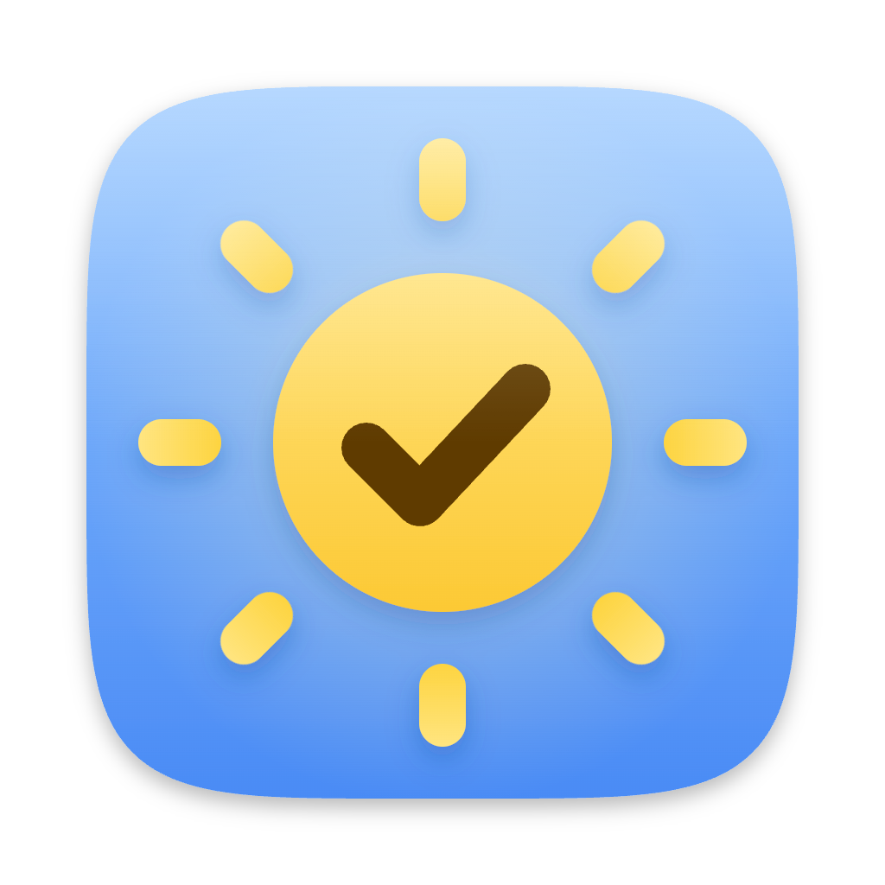
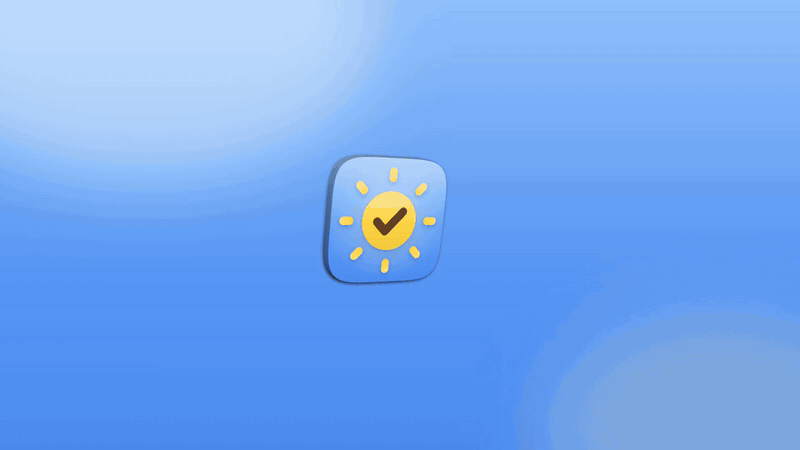
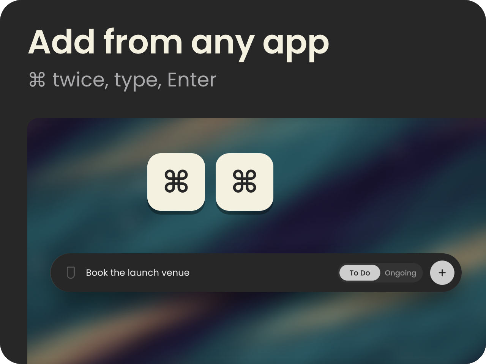
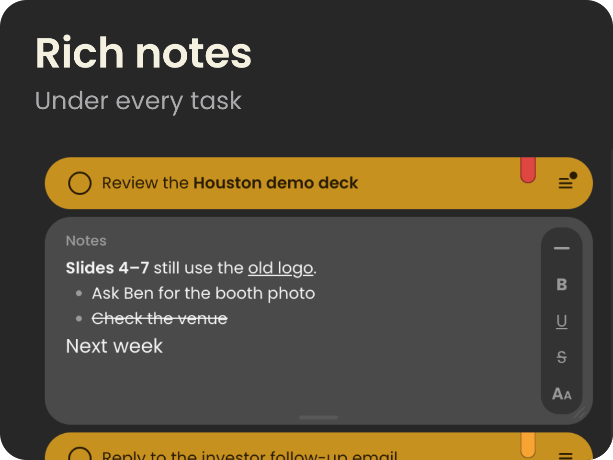
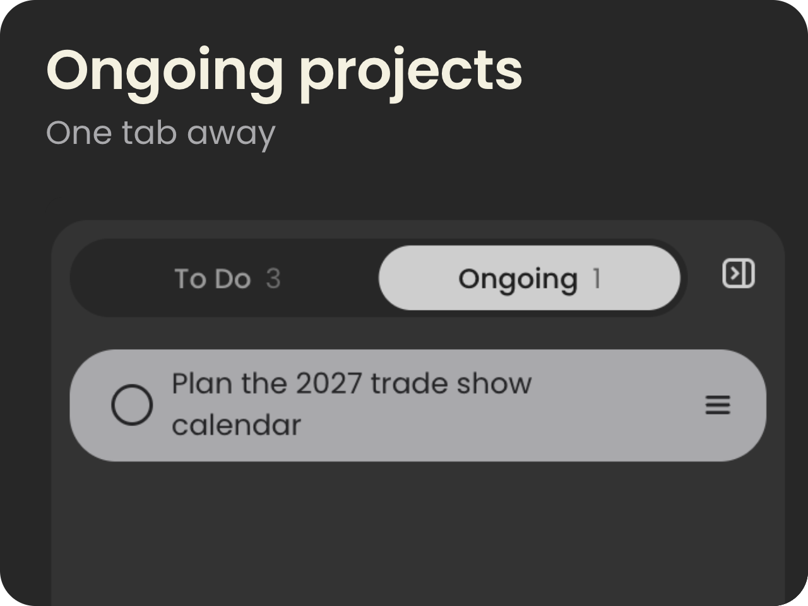
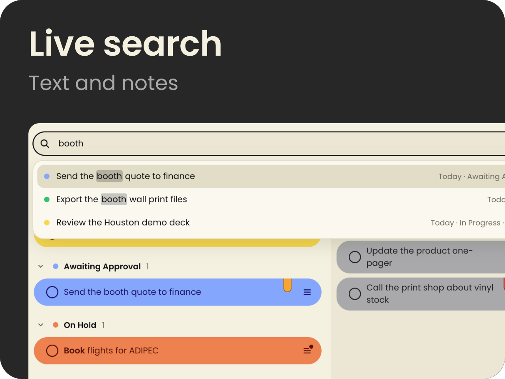

<p align="center">
  
</p>

<h1 align="center">ClearDay</h1>

<p align="center">Your whole day on one small board that floats on your Mac.</p>

<p align="center">
  <a href="https://github.com/NoamElyasim/ClearDay-daily-task-board-for-Mac/releases/latest"></a>
  <br>
  <sub>macOS 13 or later · Apple Silicon and Intel · free and open source</sub>
</p>

<p align="center">
  <a href="https://github.com/NoamElyasim/ClearDay-daily-task-board-for-Mac/releases/download/v0.8.1/ClearDay-film.mp4"></a>
  <br>
  <sub>Click the animation to watch the film with sound.</sub>
</p>

<p align="center">
  
  
</p>
<p align="center">
  
  
</p>
<p align="center">
  
  
</p>

## Talk to ClearDay through Claude

Talk to Claude in your own words and it runs your board. No commands to learn, typos welcome.

<p align="center">
  
</p>

Try saying:

- “Here are my meeting notes. Turn every action item into a task.”
- “What's still waiting for approval? Write me a follow-up for each one.”
- “Plan my day: put the 3 most urgent in progress and mark them High.”
- “Everything about the Houston event goes to Ongoing.”
- “Write my manager a status update from my board.”

Connect in one click: **Preferences → Claude**. It connects Claude Desktop, and
copies the command that adds ClearDay to Claude Code. Claude can then list,
add, update, move, search and delete your tasks. With ClearDay open, changes
appear on the board at once; with it closed, they are saved to the board's
file for next time.

Prefer Terminal? The server runs on ClearDay's own binary, so nothing else
needs installing:

```bash
claude mcp add clearday --scope user --env ELECTRON_RUN_AS_NODE=1 -- \
  /Applications/ClearDay.app/Contents/MacOS/ClearDay \
  /Applications/ClearDay.app/Contents/Resources/app.asar.unpacked/src/mcp/server.mjs
```

<details>
<summary><b>All features &amp; keyboard shortcuts</b></summary>

- **A flat, modern look.**
  - Soft pill rows set in Poppins, on a solid cream (Light) or charcoal
    (Dark) window.
  - Light mode is warm cream with bright status colours; Dark mode is
    charcoal with deeper, muted ones.
  - The rest of the interface stays black and white, so colour only ever
    means a status or a priority. Buttons invert when you point at them.
  - A light/dark switch in the header. Follow System is in Preferences.
- **Work and Personal.** Two separate boards in one app. The Work | Personal
  switch beside Add and Search flips the whole window: each board has its
  own To Do, sections, Ongoing and Done.
  - A new task goes onto the board showing. Move a task to the other board
    from its status picker.
  - Search looks in both, says which board a task is on, and takes you there.
  - Quick add and the widget have a briefcase/house button for the same
    choice.
- **Quick add from anywhere.** Press ⌘ twice in any app and a small bar
  rises above the Dock: type the task, pick Work or Personal, To Do or
  Ongoing, and a priority, then press Enter. The task goes onto the board
  without ClearDay coming forward.
  - Prefer another key, or a combination like ⌃T? Click the keycaps under
    Preferences → Quick task shortcut and press any key twice, or the
    combination.
  - A key pressed twice needs the Input Monitoring permission, which macOS
    asks for once; a combination doesn't. See
    [Quick add doesn't open](#quick-add-doesnt-open) if it stays silent.
- **The widget.** The shrink button in the header puts the board away and
  leaves one small pill on the desktop: a field for a new task, Work or
  Personal, To Do or Ongoing, and the number of tasks left today.
  - Drag it anywhere by its grip; it stays where you leave it.
  - Its arrows button brings the full board back. So does ClearDay's Dock
    or menu-bar icon.
  - It floats above other windows only with Preferences → Always on top.
- **Hide it.** The eye button in the header hides ClearDay completely,
  window and Dock icon, while it keeps running. See
  [Hiding ClearDay](#hiding-clearday) for the way back.
- **The header's buttons explain themselves.** Rest the pointer on one for
  two seconds and a tip says what it does. It stays until you move away.
- **Works with Claude.** ClearDay includes an MCP server, so Claude Code and
  Claude Desktop can list, add, update, move, search and delete your tasks,
  on either board. Connect it from Preferences → Claude.
- **Add and Search buttons.** Each opens into a field with the caret ready.
  Search shows matching tasks (text and notes, both boards) as you type;
  Enter jumps to the task.
- **Size the side panel.** Drag the edge between the board and the panel to
  make it wider or narrower; double-click the edge for the default width.
  Drag it past its narrowest and it folds away, as the button beside its
  tabs does, to give the board the full width.
- **Move the window from anywhere.** Drag any empty space: the header, the
  gaps between rows, the space under them.
- **Add to To Do or Ongoing.** The open Add bar has a To Do | Ongoing switch.
  It starts on To Do each time, so an ongoing project is a choice you make.
- **Statuses fill the row.** Click the round button on a row and pick To Do,
  In Progress, Awaiting Approval, On Hold or Done. The whole row takes that
  colour. The edit tools appear when you hover over a row.
- **Your day, top to bottom.** The board lists To Do first, then In
  Progress, Awaiting Approval and On Hold. A row moves to its new section,
  animated, when its status changes.
- **Done gathers in its own tab.** Finished tasks from To Do and Ongoing
  collect in the side panel's Done tab, the latest first; a finished ongoing
  project carries an Ongoing tag. **Clear done** deletes them all, with Undo.
- **Fold a section away.** Click the chevron beside its heading to hide its
  tasks. The count stays, and the app remembers what you folded.
  **Collapse**, level with the first heading, folds every section; once
  they are all folded it turns into **Expand**.
- **Select several tasks.** **Select** (beside Collapse) puts a tick
  circle on every row: click rows to pick them, ⌘A picks every task in view,
  then **Delete** removes them together. One Undo (or ⌘Z) brings them all
  back. Cancel or Esc leaves selecting.
- **Ongoing projects.** Long-term work lives in the side panel's Ongoing tab,
  grouped by the same statuses, beside Done; Ongoing | Done is a switch with
  a sliding knob. The board always shows today.
  - Move a task between To Do and Ongoing from the status picker, or by
    dragging it onto the board or into an Ongoing group.
  - Drag a task onto the Done tab to finish it.
- **Priority bookmarks.** A red (High) or amber (Medium) bookmark hangs from
  the top of the row. Click it to change the priority; on a row without one,
  a faint bookmark appears when you point at the row.
- **Edit in place.** Double-click a task to change its text.
- **Partial bold.** Select a word and press ⌘B or the B button. With nothing
  selected, B bolds the whole row.
- **Notes.** The ≡ button opens a notes panel attached under the task. The
  same button closes it, and so does a click anywhere else. One note is
  open at a time.
  - Notes are rich text: bold, underline, strikethrough and four text sizes
    from a small menu at the note's side, which folds away to an arrow.
  - Type "- " to start a bulleted list. Enter continues it, and Backspace on
    an empty bullet ends it.
  - Paste or drop an image and it shows in the note; drop a PDF or any other
    file and it becomes a chip. ClearDay keeps its own copy (up to 50 MB),
    so it still opens after you move the original. Click either to open it.
    The paperclip beside the note's label attaches from a file picker.
  - Web addresses become links as you type or paste them. Select words and
    press ⌘K (or the link button) to link them; ⌘K on a link edits or
    removes it. A click opens a link in your browser.
  - It saves as you type and resizes from its bottom edge.
  - Right-click in a note for spelling suggestions, Look Up, speech, and
    writing direction: left to right or right to left, kept per note.
- **Responsive layout.**
  - A wide window shows the board and the Ongoing | Done panel side by side.
  - A narrow window shows one column, with the panel in a drawer on the
    right and the row tools behind "…".
  - In the narrow layout, Ongoing and Done each get a tab on the bottom
    edge.
- **Sorting.** Default (by status), By priority, By creation time, or Manual.
  Default and Manual let you drag rows to reorder them, between sections,
  and between the board and the side panel.
- **Undo.** A deleted task can be restored from the toast or with ⌘Z.
- **Updates come to you.** When a new version is out, a notice offers to
  install it: one click and ClearDay restarts on it, your board kept.
  Preferences → About checks on demand. ClearDay only asks GitHub for the
  latest release; nothing about you or your tasks is sent.
- **Your day carries over.** At midnight only the date changes. Nothing is
  cleared or archived.
- **Preferences** (the gear, or ⌘,):
  - Appearance: theme, text size and the weekday.
  - Behavior: always on top, Dock or menu bar only, launch at login, sort,
    spell checking, and quick add with its shortcut.
  - Data: show the data folder, export your tasks, reset the window position.
  - A list of keyboard shortcuts.

#### Keyboard

| Key | Action |
|---|---|
| Enter | Add the task you typed. On a selected row, edit it |
| ⌘ ⌘ (twice, in any app) | Quick add. Any key twice or any combination instead: Preferences → Quick task shortcut |
| ⌘N | Open Add a task |
| ⌘F | Search |
| ↑ / ↓ | Select a row |
| ⌘B | Bold the selection, or the whole row. In a note: bold |
| ⌘U / ⇧⌘X | In a note: underline / strikethrough |
| ⌘K | In a note: link the selected words, or edit a link |
| ⌘⌫ | Delete the selected task, or the picked tasks while selecting |
| ⌘A | While selecting: pick every task in view |
| ⌘Z | Undo the last delete |
| ⌘, | Preferences |
| Esc | Cancel an edit, or close a picker, the drawer or Preferences |

</details>

## Hiding ClearDay

The eye button in the header hides ClearDay: the window and the Dock icon
both go, and ClearDay keeps running, so quick add still works.

To bring it back, click ClearDay's icon in the menu bar, at the top right of
the screen. It looks like a short task list: three small circles, each with
a line.

**Can't find ClearDay?** On a crowded menu bar, a MacBook's notch can cover
the icon. Open ClearDay again from Spotlight (⌘Space, type ClearDay, Enter)
or from the Applications folder, and the window comes back.

## Quick add doesn't open

Pressing ⌘ twice (or your own key twice) needs macOS's Input Monitoring
permission. If nothing happens:

1. Open **Preferences → Quick task shortcut**. It says whether the shortcut
   is ready or waiting for permission.
2. Press **Ask macOS again**, then choose **Open System Settings** in the
   message macOS shows and switch ClearDay on under Input Monitoring.

This also fixes two traps: a **Deny** pressed by mistake, and ClearDay
showing as switched on in System Settings while the shortcut stays silent.
The second happened after updates up to 0.9.0. From 0.10.0 the permission
survives updates.

A combination such as ⌃T needs no permission.

## Install

ClearDay needs macOS 13 or later.

### In one line

Paste this into Terminal:

```bash
curl -fsSL https://raw.githubusercontent.com/NoamElyasim/ClearDay-daily-task-board-for-Mac/main/install.sh | bash
```

It downloads the latest release for your Mac (Apple Silicon or Intel), puts
ClearDay in Applications and opens it. No warning from macOS to click
through, and no password. Run the same line again to update.
You can [read the script](install.sh) before you run it.

### From the DMG

1. Download the latest DMG from
   [Releases](https://github.com/NoamElyasim/ClearDay-daily-task-board-for-Mac/releases/latest):
   `arm64` for Apple Silicon (M1 and later), `x64` for Intel Macs.
2. Open it and drag ClearDay into Applications.
3. Open ClearDay. ClearDay isn't notarized by Apple yet, so the first time
   macOS says it can't verify the app:
   - Click **Done** in that message.
   - Open **System Settings → Privacy & Security**, scroll down, and click
     **Open Anyway** next to the ClearDay line.
   - Confirm with **Open Anyway** and your password.

   After that it opens like any other app. If you're at home in Terminal,
   this does the same in one line:

   ```bash
   xattr -dr com.apple.quarantine /Applications/ClearDay.app
   ```

### Build it yourself

```bash
git clone https://github.com/NoamElyasim/ClearDay-daily-task-board-for-Mac.git
cd ClearDay-daily-task-board-for-Mac
npm install
npm run install:mac      # builds, signs locally, copies to /Applications, opens it
```

`npm run dist:mac` builds both DMGs into `dist/`. To sign and notarize them
with an Apple Developer ID, see [docs/notarize.md](docs/notarize.md).

## Develop

```bash
npm start                # run from source
npm test                 # unit tests for the task model
npm run e2e              # drives the real UI with clicks, keys and drags
npm run shots            # renders every look to tools/shots/out/
npm run readme           # redraws the README art in docs/readme/ from those shots
```

`CLEARDAY_USER_DATA=/some/folder npm start` runs against a scratch board.
Running it that way leaves your real board untouched.

### Layout

```
src/main/       main process: window, widget, menus, tray, settings, task store, right-click menu
src/preload.cjs the renderer's API (window.clearday)
src/shared/     the task model: plain functions shared by both sides
src/renderer/   the UI; theme.css holds every colour
```

### Data

Tasks are kept in `~/Library/Application Support/ClearDay/tasks.json`. The
format is plain, versioned JSON, ready for syncing to a phone later:

- every task has an ID, a `createdAt` and an `updatedAt` timestamp
- every task has a `space`, `work` or `personal`
- deleted tasks are kept as tombstones for 30 days

Window size, theme and the other settings live in a separate
`settings.json`, because they belong to this Mac.

## License

[MIT](LICENSE)

## Film credits

- Desk photo: "Apple-desk-laptop-macbook" on Wikimedia Commons, public domain (CC0).
- "Suspense Whoosh/Transition" by tyops on Freesound, CC BY 4.0
  (https://freesound.org/people/tyops/sounds/275143).
- Music from the HeyGen music library.

[](https://m8ven.ai/mcp/noamelyasim-clearday-daily-task-board-for-mac-3a1sb9?s=readme)
