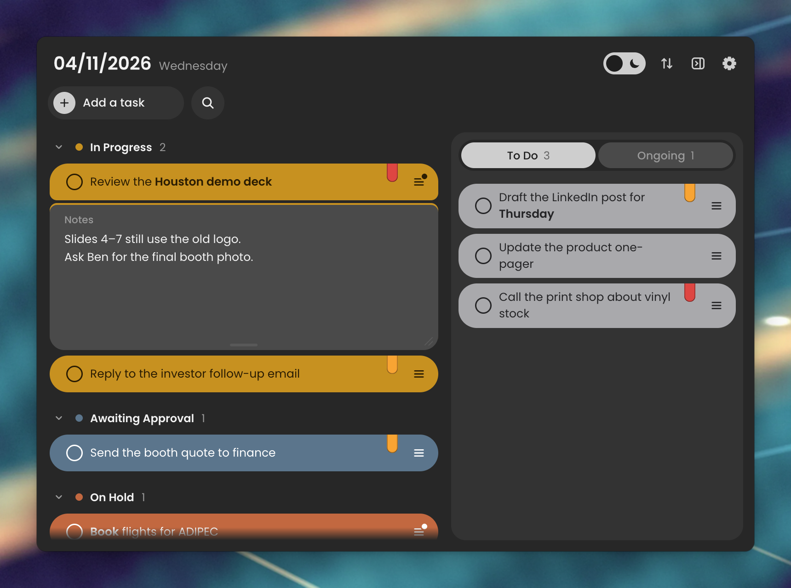
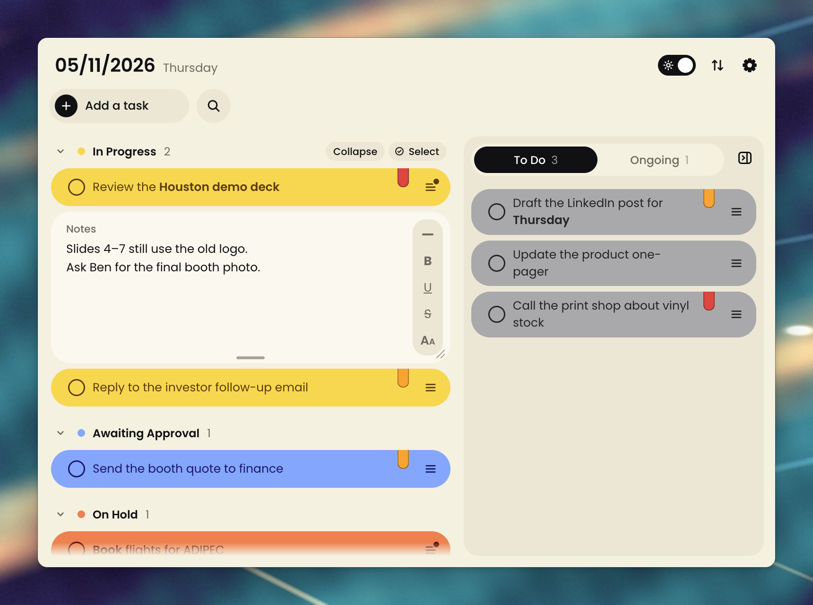
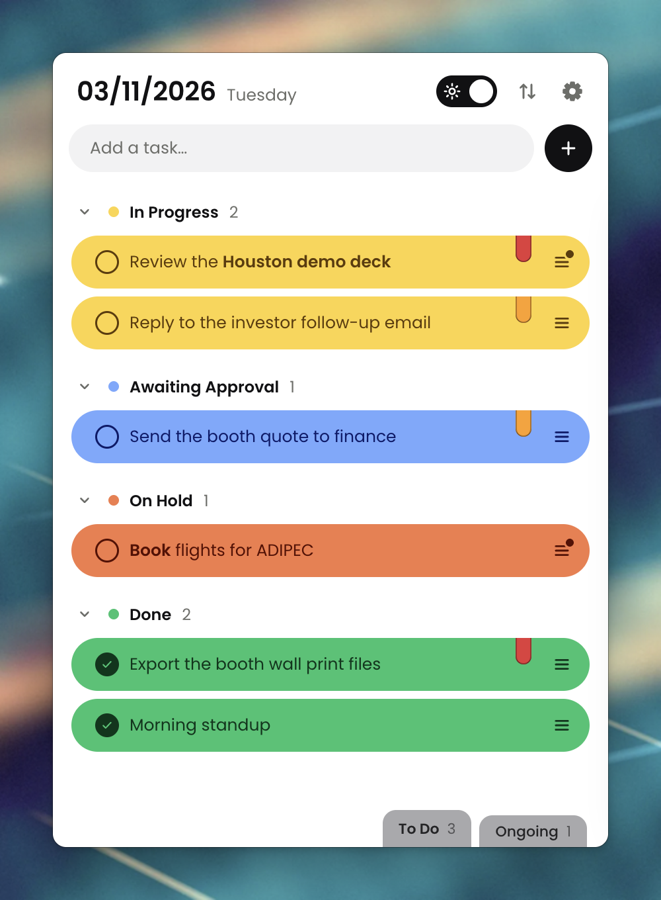
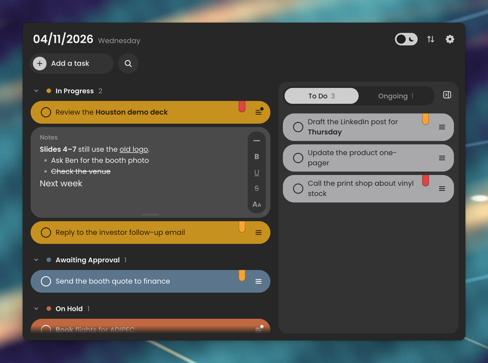
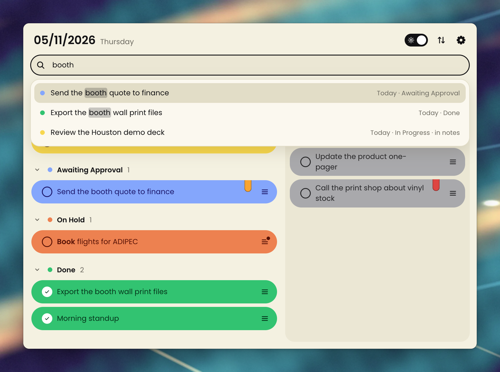
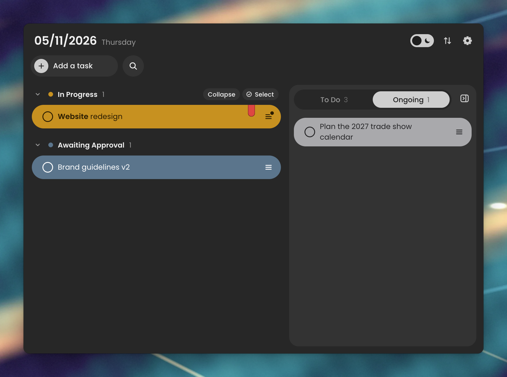
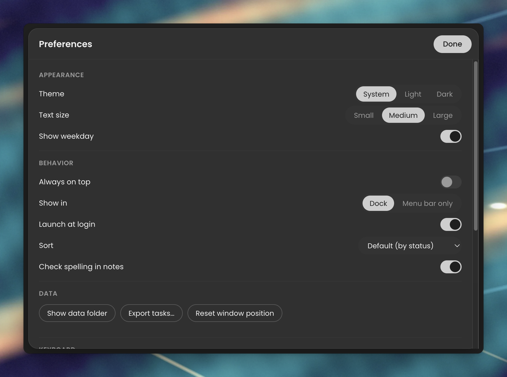

# ClearDay

A compact, Monday-style daily task board that floats on your Mac desktop.
One window, one day: set what's in progress, what's waiting for approval,
what's on hold and what's done, with the to-do list and your long-term
projects beside it.

[](https://github.com/NoamElyasim/ClearDay-daily-task-board-for-Mac/releases/download/v0.7.1/ClearDay-film.mp4)

<sub>Click the animation to watch the film with sound.</sub>



| Light | Compact |
|---|---|
|  |  |

| Notes | Search |
|---|---|
|  |  |

| Ongoing projects | Preferences |
|---|---|
|  |  |

## Features

- **A flat, modern look.**
  - Soft pill rows set in Poppins, on a solid cream (Light) or charcoal
    (Dark) window.
  - Light mode is warm cream with bright status colours; Dark mode is
    charcoal with deeper, muted ones.
  - The rest of the interface stays black and white, so colour only ever
    means a status or a priority. Buttons invert when you point at them.
  - A light/dark switch in the header. Follow System is in Preferences.
- **Quick add from anywhere.** Press ⌘ twice in any app and a small bar
  rises above the Dock: type the task, pick To Do or Ongoing and a priority,
  press Enter. The task goes onto the board without ClearDay coming forward.
  It needs the Input Monitoring permission, which macOS asks for once.
- **Works with Claude.** ClearDay includes an MCP server, so Claude Code and
  Claude Desktop can list, add, update, move, search and delete your tasks.
  Connect it from Preferences → Claude.
- **Add and Search buttons.** Each opens into a field with the caret ready.
  Search shows matching tasks (text and notes, both lists) as you type;
  Enter jumps to the task.
- **Hide the side panel** with the button beside its tabs to give the board
  the full width.
- **Move the window from anywhere.** Drag any empty space: the header, the
  gaps between rows, the space under them.
- **Statuses fill the row.** Click the round button on a row and pick To Do,
  In Progress, Awaiting Approval, On Hold or Done. The whole row takes that
  colour. The edit tools appear when you hover over a row.
- **To Do in its own panel.** The board lists In Progress first, then
  Awaiting Approval, then On Hold, then Done. A row moves to its new section,
  animated, when its status changes.
- **Fold a section away.** Click the chevron beside its heading to hide its
  tasks. The count stays, and the app remembers what you folded.
  **Collapse**, level with the first heading, folds every section; once
  they are all folded it turns into **Expand**.
- **Select several tasks.** **Select** (beside Collapse) puts a tick
  circle on every row: click rows to pick them, ⌘A picks every task in view,
  then **Delete** removes them together. One Undo (or ⌘Z) brings them all
  back. Cancel or Esc leaves selecting.
- **Ongoing projects.** Long-term work lives in an Ongoing tab beside To Do;
  To Do | Ongoing is a switch with a sliding knob.
  - With that tab open, the board shows your ongoing projects in the same
    status sections, and the side keeps their To Do. The To Do tab brings
    back today's board.
  - Move a task between Today and Ongoing from the status picker, or by
    dragging it.
  - New tasks go to whichever tab is open.
- **Priority bookmarks.** A red (High) or amber (Medium) bookmark hangs from
  the top of the row. Click it to change the priority; on a row without one,
  a faint bookmark appears when you point at the row.
- **Edit in place.** Double-click a task to change its text.
- **Partial bold.** Select a word and press ⌘B or the B button. With nothing
  selected, B bolds the whole row.
- **Notes.** The ≡ button opens a notes panel attached under the task. The
  same button closes it, and so does a click anywhere else. One note is
  open at a time.
  - Notes are rich text: bold, underline, strikethrough and four text sizes
    from a small menu at the note's side, which folds away to an arrow.
  - Type "- " to start a bulleted list. Enter continues it, and Backspace on
    an empty bullet ends it.
  - It saves as you type and resizes from its bottom edge.
  - Right-click in a note for spelling suggestions, Look Up, speech, and
    writing direction: left to right or right to left, kept per note.
- **Responsive layout.**
  - A wide window shows the board and the To Do panel side by side.
  - A narrow window shows one column, with To Do in a drawer on the right
    and the row tools behind "…".
  - In the narrow layout, To Do and Ongoing each get a tab on the bottom
    edge.
- **Sorting.** Default (by status), By priority, By creation time, or Manual.
  Default and Manual let you drag rows to reorder them, and drag rows between
  To Do and the board.
- **Undo.** A deleted task can be restored from the toast or with ⌘Z.
- **Your day carries over.** At midnight only the date changes. Nothing is
  cleared or archived.
- **Preferences** (the gear, or ⌘,):
  - Appearance: theme, text size and the weekday.
  - Behavior: always on top, Dock or menu bar only, launch at login, sort and
    spell checking.
  - Data: show the data folder, export your tasks, reset the window position.
  - A list of keyboard shortcuts.

### Keyboard

| Key | Action |
|---|---|
| Enter | Add the task you typed. On a selected row, edit it |
| ⌘ ⌘ (twice, in any app) | Quick add |
| ⌘N | Open Add a task |
| ⌘F | Search |
| ↑ / ↓ | Select a row |
| ⌘B | Bold the selection, or the whole row. In a note: bold |
| ⌘U / ⇧⌘X | In a note: underline / strikethrough |
| ⌘⌫ | Delete the selected task, or the picked tasks while selecting |
| ⌘A | While selecting: pick every task in view |
| ⌘Z | Undo the last delete |
| ⌘, | Preferences |
| Esc | Cancel an edit, or close a picker, the drawer or Preferences |

## Install

ClearDay needs macOS 13 or later.

1. Download the latest DMG from
   [Releases](https://github.com/NoamElyasim/ClearDay-daily-task-board-for-Mac/releases/latest):
   `arm64` for Apple Silicon (M1 and later), `x64` for Intel Macs.
2. Open it and drag ClearDay into Applications.
3. Open ClearDay. ClearDay isn't notarized by Apple yet, so the first time
   macOS says it can't verify the app:
   - Click **Done** in that message.
   - Open **System Settings → Privacy & Security**, scroll down, and click
     **Open Anyway** next to the ClearDay line.
   - Confirm with **Open Anyway** and your password.

   After that it opens like any other app. If you're at home in Terminal,
   this does the same in one line:

   ```bash
   xattr -dr com.apple.quarantine /Applications/ClearDay.app
   ```

### Build it yourself

```bash
git clone https://github.com/NoamElyasim/ClearDay-daily-task-board-for-Mac.git
cd ClearDay-daily-task-board-for-Mac
npm install
npm run install:mac      # builds, signs locally, copies to /Applications, opens it
```

`npm run dist:mac` builds both DMGs into `dist/`.

## Claude (MCP)

Preferences → Claude connects ClearDay to Claude Desktop in one click, and
copies the command that adds it to Claude Code. Claude then has these tools:
`list_tasks`, `add_task`, `update_task`, `delete_task` and `search_tasks`.
With ClearDay open, changes appear on the board at once; with it closed,
they are saved to the board's file for next time.

The server runs on ClearDay's own binary, so nothing else needs installing:

```bash
claude mcp add clearday --scope user --env ELECTRON_RUN_AS_NODE=1 -- \
  /Applications/ClearDay.app/Contents/MacOS/ClearDay \
  /Applications/ClearDay.app/Contents/Resources/app.asar.unpacked/src/mcp/server.mjs
```

## Develop

```bash
npm start                # run from source
npm test                 # unit tests for the task model
npm run e2e              # drives the real UI with clicks, keys and drags
npm run shots            # renders every look to tools/shots/out/
npm run shots -- --docs  # …and refreshes the README images
```

`CLEARDAY_USER_DATA=/some/folder npm start` runs against a scratch board.
Running it that way leaves your real board untouched.

### Layout

```
src/main/       main process: window, menus, tray, settings, task store, right-click menu
src/preload.cjs the renderer's API (window.clearday)
src/shared/     the task model: plain functions shared by both sides
src/renderer/   the UI; theme.css holds every colour
```

### Data

Tasks are kept in `~/Library/Application Support/ClearDay/tasks.json`. The
format is plain, versioned JSON, ready for syncing to a phone later:

- every task has an ID, a `createdAt` and an `updatedAt` timestamp
- deleted tasks are kept as tombstones for 30 days

Window size, theme and the other settings live in a separate
`settings.json`, because they belong to this Mac.

## License

[MIT](LICENSE)

## Film credits

- Desk photo: "Apple-desk-laptop-macbook" on Wikimedia Commons, public domain (CC0).
- "Suspense Whoosh/Transition" by tyops on Freesound, CC BY 4.0
  (https://freesound.org/people/tyops/sounds/275143).
- Music from the HeyGen music library.
